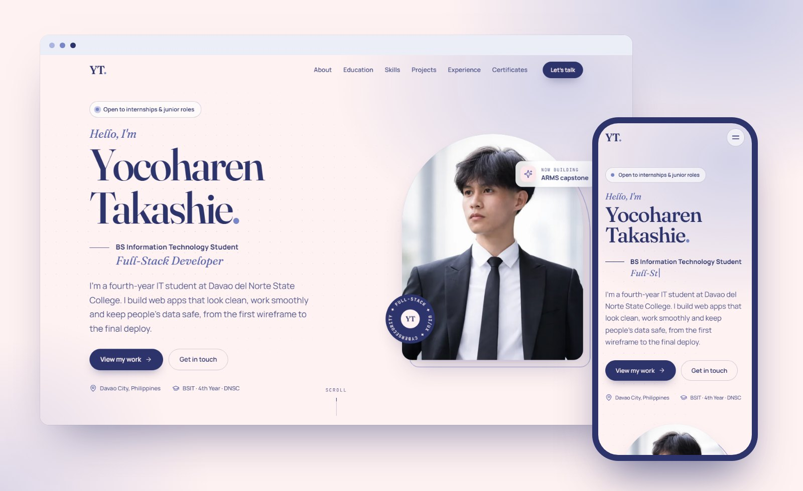

# Yocoharen Takashie · Curriculum Vitae

A personal CV website for **Yocoharen Takashie**, a fourth-year BS Information Technology student at Davao del Norte State College. It presents my profile, education, skills, projects, experience and certificates in an editorial design, built with plain HTML, CSS and JavaScript and deployed on Vercel.

- **Live site:** _link added after the first Vercel deployment_
- **Student:** Yocoharen Takashie, BSIT 4th Year, Institute of Computing, Davao del Norte State College
- **GitHub:** [@Yoko-Haren](https://github.com/Yoko-Haren) · **LinkedIn:** [Yocoharen Takashie](https://www.linkedin.com/in/yocoharen-takashie-14917a354)



## What's on the page

| # | Section | Contents |
|---|---|---|
| | Hero | Full name, professional title, typing roles, short introduction, portrait |
| 01 | About | Personal description, career objective, basic information, career interests |
| 02 | Education | Davao del Norte State College (BSIT, 4th year) and Panabo City National High School (STEM, With Honors) |
| 03 | Skills | Technical skills with animated progress bars, everyday tools, soft skills |
| 04 | Projects | ARMS (capstone), Campus Store POS Kiosk and Monora, with screenshots and links |
| 05 | Experience | Lead full-stack developer on the ARMS capstone; freelance data entry and lead generation |
| 06 | Certificates | Cisco CCNA: Switching, Routing, and Wireless Essentials; AI for Innovation of Capstone Projects seminar |
| 07 | Contact | Email, phone, location, GitHub and LinkedIn profiles, message form |

## Features

- **Editorial design** in a blush, mist, periwinkle and navy palette, with Fraunces headlines and Manrope body text
- **Animations:** staggered hero entrance, typing roles, rotating badge, scrolling marquee, scroll reveals, skill bars with counting percentages, a timeline that draws as you scroll, tilting project previews, a certificate viewer, and a back-to-top button whose ring fills as you read
- **Reduced motion:** every animation turns off for visitors who set "reduce motion" on their device
- **Responsive:** tested at 320, 375, 414, 768, 1024 and 1440 px wide, with a full-screen menu on phones and tablets
- **Accessible:** semantic HTML, a skip link, keyboard-friendly menu and dialog, visible focus styles, alt text and AA color contrast
- **Works without JavaScript:** all content is in the HTML; scripts only add motion and interaction
- **Fast:** no frameworks, WebP images in several sizes with lazy loading
- **Secure headers:** a Content-Security-Policy and other security headers set in `vercel.json`

## Technologies

- **HTML5:** semantic sections, `<dialog>`, inline SVG icon sprite, Open Graph tags and structured data
- **CSS3:** custom properties, Grid and Flexbox, `clamp()` fluid type, keyframe animations, media queries
- **JavaScript (ES modules):** IntersectionObserver, Clipboard API, Fetch API (live GitHub repository count)
- **Git and GitHub** for version control, **Vercel** for hosting
- **Fonts:** Fraunces, Manrope and JetBrains Mono from Google Fonts
- **Icons:** [Lucide](https://lucide.dev) (ISC license) and GitHub [Octicons](https://primer.style/octicons) (MIT license)

## Color palette

| Color | Hex | Used for |
|---|---|---|
| Blush | `#FFF2F2` | Page background, text on navy |
| Mist | `#A9B5DF` | Soft accents, bar tracks, highlights on navy |
| Periwinkle | `#7886C7` | Italic accents, progress bars, details |
| Navy | `#2D336B` | Text, buttons, dark sections |

## Project structure

```text
curriculum-vitae/
├── index.html            # the CV page
├── 404.html              # custom "page not found" page
├── vercel.json           # clean URLs, security and caching headers
├── favicon.ico
├── assets/
│   ├── icons/            # SVG favicon and Apple touch icon
│   └── img/              # portrait, project screenshots, certificates, link preview
├── css/
│   ├── tokens.css        # colors, fonts, spacing, shadows, motion timing
│   ├── base.css          # reset, typography defaults, utilities
│   ├── layout.css        # sections, headings, dark and tinted themes, marquee
│   ├── components.css    # buttons, tags, pills
│   ├── animations.css    # keyframes, hero entrance, scroll reveal, reduced motion
│   ├── 404.css
│   └── sections/         # one stylesheet per section
├── js/
│   ├── main.js           # entry point that starts each module
│   └── modules/          # nav, typing, reveal, timeline, skills, tilt,
│                         # lightbox, contact, github, back-to-top, toast
└── docs/
    └── preview.jpg       # screenshot used in this README
```

## Run it locally

The scripts are ES modules, so open the site through a local server rather than double-clicking `index.html`:

```bash
python -m http.server 5173
```

Then visit <http://localhost:5173>.

## Deployment

The site is a static site with no build step. Vercel deploys it straight from the `main` branch of this repository, and every push publishes a new version automatically.

## Author

**Yocoharen Takashie**, BS Information Technology, Davao del Norte State College
[GitHub](https://github.com/Yoko-Haren) · [LinkedIn](https://www.linkedin.com/in/yocoharen-takashie-14917a354) · yocoharen24@gmail.com
